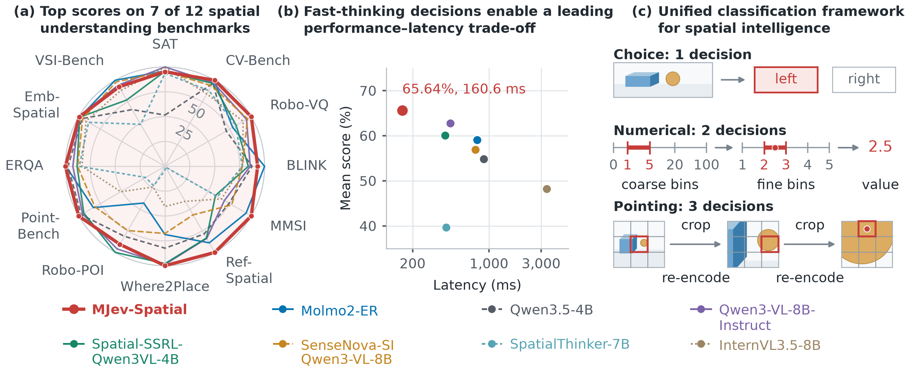
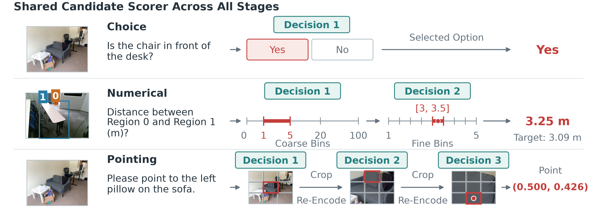
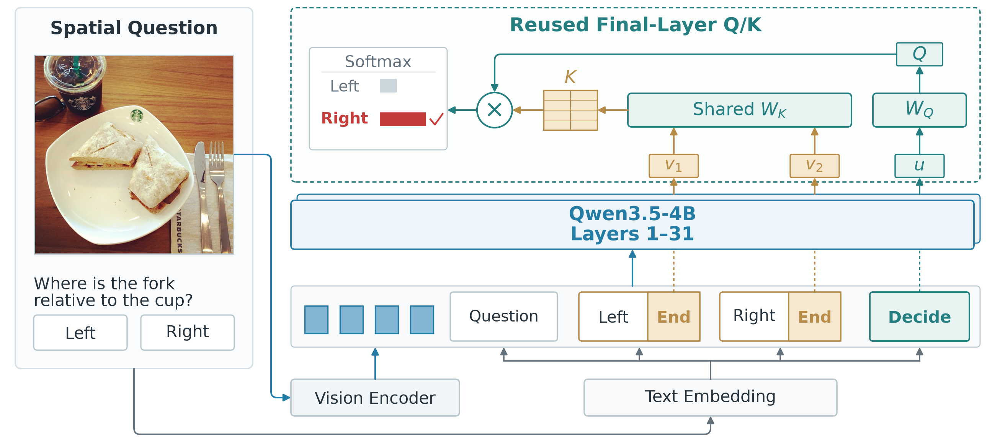

<div align="center">


[](LICENSE)
[](https://huggingface.co/mindlab-research/MJev-Spatial-4B)
[](https://arxiv.org/abs/2610.22276)

English · [简体中文](README-zh.md)

</div>

MJev-Spatial is a multimodal decision model for spatial understanding. It turns a spatial question into a finite candidate-selection problem, so the model can make a decision directly instead of generating an answer string and parsing it afterward.

The model is built on Qwen3.5-4B and reuses the backbone's pretrained query and key projections to score candidates. The released readout does not add a separate prediction head. Each decision is completed in one forward pass and produces no answer tokens.

The current model checkpoint is available at [mindlab-research/MJev-Spatial-4B](https://huggingface.co/mindlab-research/MJev-Spatial-4B). The paper is [MJev-Spatial: System One Spatial Intelligence via Native Attention Matching](https://arxiv.org/abs/2610.22276).



## What the model does

MJev-Spatial uses one candidate-scoring interface for three output types:

- **Choice:** select one of the options supplied with the request.
- **Numerical prediction:** select a coarse value interval and then a finer interval; decode the selected interval to a value.
- **Pointing:** select a region in a 3×3 grid for three stages, re-encoding the selected crop between stages; decode the final cell center as normalized image coordinates.

The candidate set is part of the task contract. The model scores only legal candidates for the current stage, masks padded candidates, and returns the selected candidate together with its scores and decision path.



## Model readout

For a decision position and a candidate position, the model reads hidden states from the language backbone and applies the final full-attention block's native projections:

\[
z_i = \frac{1}{H}\sum_{h=1}^{H}
\frac{Q_h(h_{\mathrm{decision}})^\top K_h(h_{\mathrm{candidate}})}{\sqrt{d_h}}.
\]

The released configuration uses the final full-attention layer, native Q/K normalization, grouped-query-key alignment, and multimodal rotary position encoding. Score logits are normalized over the current candidate set.




## Installation

The public package targets Python 3.10 or newer and a CUDA-capable PyTorch installation.

```bash
git clone https://github.com/Fr0zenCrane/MJev-Spatial.git
cd MJev-Spatial
python -m venv .venv
source .venv/bin/activate
pip install -e '.[inference,train]'
```

Install the PyTorch build that matches your CUDA driver before installing the package if your environment does not already provide it.

## Checkpoint layout

The inference and training commands accept a local checkpoint directory. A released checkpoint contains the model configuration, processor files, and language-model weights in the layout expected by `scripts/predict.py` and `scripts/train.py`.

```bash
export MJEV_CHECKPOINT=/path/to/mjev-spatial-checkpoint
```

Model weights are distributed from [Hugging Face](https://huggingface.co/Fr0zencr4nE/MJev-Spatial-Qwen-3.5-4B); this repository contains the source code and examples.

## Run inference

Requests are JSON objects. An inference request contains an image, a question, and its candidate contract. The examples directory contains small synthetic requests that can be run without any private dataset.

```bash
python scripts/predict.py \
  --checkpoint "$MJEV_CHECKPOINT" \
  --input examples/requests.jsonl \
  --output predictions.jsonl
```

A prediction contains the decoded answer, the decision path, and the candidate scores for each stage.

### Request examples

Choice:

```json
{
  "id": "choice-0001",
  "input": {
    "media": [{"kind": "image", "uri": "examples/images/scene.png"}],
    "question": "Where is the red square relative to the blue circle?",
    "answer_space": {
      "kind": "choice",
      "options": [
        {"id": "left", "text": "left"},
        {"id": "right", "text": "right"}
      ]
    }
  }
}
```

Scalar:

```json
{
  "id": "scalar-0001",
  "input": {
    "media": [{"kind": "image", "uri": "examples/images/scene.png"}],
    "question": "What is the approximate distance between the two objects?",
    "answer_space": {"kind": "scalar", "quantity": "distance", "unit": "m"}
  }
}
```

Pointing:

```json
{
  "id": "point-0001",
  "input": {
    "media": [{"kind": "image", "uri": "examples/images/scene.png"}],
    "question": "Point to the blue circle.",
    "answer_space": {
      "kind": "point",
      "coordinate_system": "normalized_xy",
      "num_points": 1
    }
  }
}
```

Image paths are resolved relative to the current working directory or according to the path rules documented by the selected command.

## Continue training on your data

The public training interface consumes already-labeled records in the same typed format. It does not require a particular benchmark or dataset source. Prepare your own images and annotations, write them to JSONL, and keep the task contract and target in the same record.

```json
{
  "id": "train-choice-0001",
  "input": {
    "media": [{"kind": "image", "uri": "my_data/images/example.png"}],
    "question": "Is the box to the left of the chair?",
    "answer_space": {
      "kind": "choice",
      "options": [
        {"id": "yes", "text": "yes"},
        {"id": "no", "text": "no"}
      ]
    }
  },
  "target": {"option_id": "yes"}
}
```

For numerical records, use `target.value` and the unit declared by `answer_space`. For point records, use normalized `[x, y]` coordinates in `target.points`:

```json
{"target": {"value": 2.4, "unit": "m"}}
```

```json
{"target": {"points": [[0.62, 0.41]]}}
```

Run a small supervised update with the sample records:

```bash
python scripts/train.py \
  --checkpoint "$MJEV_CHECKPOINT" \
  --data examples/train.jsonl \
  --config configs/finetune.json \
  --output runs/example-finetune
```

The training command saves a reloadable checkpoint. Use that checkpoint with `scripts/predict.py` and `scripts/evaluate.py`.

The default recipe keeps the vision encoder and vision-language projector frozen and updates the language-side model parameters used by the decision readout. Training settings such as learning rate, batch size, gradient accumulation, precision, and checkpoint frequency are configurable.

## Evaluate a checkpoint

Evaluation uses the same public record format and reads targets from the evaluation JSONL:

```bash
python scripts/evaluate.py \
  --checkpoint runs/example-finetune \
  --data examples/eval.jsonl \
  --output runs/example-finetune/evaluation.json
```

The basic evaluator reports choice accuracy, scalar error, and point distance/hit metrics according to the task type present in the input records.

## Scope of this repository

This repository contains the model runtime, the basic training loop, a public evaluator, examples, and tests. The intended workflow is to load the released model, run it on your inputs, or continue training it with your own labeled records.

## License

The source code is released under the Apache License 2.0. See [LICENSE](LICENSE) and [NOTICE](NOTICE) for third-party attribution.
